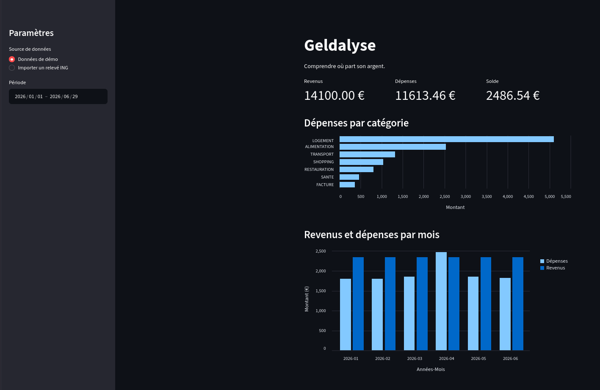

# Geldalyse

[](https://github.com/maxime2k/geldalyse/actions/workflows/tests.yml)

> Comprendre où part son argent, en quelques secondes.

Geldalyse est une application Python qui importe un relevé bancaire, catégorise automatiquement les transactions et affiche un tableau de bord des entrées et des sorties d'argent.



**[Voir la démo en ligne](https://geldalyse.streamlit.app/)**

---

## Fonctionnalités

- **Deux sources de données** : des transactions fictives générées à la volée, ou un export CSV d'ING Belgique (en français)
- **Nettoyage automatique** : colonnes renommées, dates converties, libellés normalisés, lignes vides supprimées
- **Catégorisation automatique** selon les mots-clés et le signe du montant :
  - une sortie reçoit une catégorie de sortie (alimentation, transport, logement…) ;
  - une entrée reçoit une catégorie d'entrée (salaire, intérêts) ; à défaut, un virement reçu est classé en remboursement, et toute autre entrée en « autres entrées » ;
  - un remboursement de magasin garde la catégorie de sa dépense, et la réduit
- **Libellé court lisible** : le commerçant, le bénéficiaire d'un virement ou la nature d'une opération bancaire, extrait de la longue description de la banque
- **Correction manuelle des catégories** : pour une opération non catégorisée, ou depuis le tableau des transactions. Un choix s'applique à toutes les transactions de l'opération, sans jamais transformer une entrée en sortie
- **Gestion des erreurs d'import** : un fichier au mauvais format affiche un message clair, sans faire planter l'application
- **Tableau de bord interactif**, en deux pages :
  - **Vue d'ensemble** : entrées, sorties et solde de la période ; sorties et entrées par catégorie, en deux onglets, avec le montant de chaque catégorie ; entrées et sorties mois par mois
  - **Transactions** : transactions non catégorisées, regroupées par opération ; tableau détaillé, en deux onglets, avec un libellé court et la description complète
  - filtre de période, filtre des transactions par catégorie et indicateur des transactions non catégorisées, dans la barre latérale

## Architecture

Le projet suit un schéma **ETL** (*Extract, Transform, Load*). Chaque étape est un module indépendant et testé.

| Étape | Module | Rôle |
|---|---|---|
| Extract | `reader.py` | Lit un export bancaire CSV |
| Extract | `generator.py` | Génère des transactions fictives reproductibles |
| Transform | `reader.py` | Convertit les données au format standard |
| Transform | `categorizer.py` | Attribue une catégorie selon les mots-clés et le signe du montant, et applique les choix manuels |
| Transform | `merchant.py` | Extrait le nom de la contrepartie et reconnaît les virements reçus |
| Transform | `analysis.py` | Calcule les chiffres clés et les agrégats |
| Load | `app.py` | Point d'entrée : barre latérale, chargement des données et navigation |
| Load | `views/` | Une page du tableau de bord par fichier |
| Load | `components.py` | Fonctions d'affichage partagées par les pages |

Toutes les sources de données produisent le même **format standard**, défini dans `schema.py`. Ajouter une nouvelle banque ne demande donc qu'un nouveau lecteur : le reste de l'application ne change pas.

La logique (`src/geldalyse/`) ne dépend pas de Streamlit : elle est testée seule, et pourrait servir une autre interface.

```
geldalyse/
├── app.py                  # Point d'entrée : barre latérale, chargement et navigation
├── components.py           # Fonctions d'affichage partagées par les pages
├── views/
│   ├── overview.py         # Vue d'ensemble : chiffres clés, catégories, mois par mois
│   └── transactions.py     # Transactions : non catégorisées et tableau modifiable
├── src/geldalyse/
│   ├── analysis.py         # Chiffres clés et agrégats
│   ├── categorizer.py      # Catégorisation par mots-clés et signe du montant
│   ├── generator.py        # Transactions fictives
│   ├── merchant.py         # Libellé court et reconnaissance des virements reçus
│   ├── reader.py           # Lecture des exports ING
│   └── schema.py           # Format standard des données
├── tests/                  # Tests unitaires et d'intégration (pytest)
│   └── fixtures/           # Relevés synthétiques, valides et invalides
├── docs/                   # Conception du tableau de bord
└── .github/workflows/      # Intégration continue (GitHub Actions)
```

## Qualité et intégration continue

- **Tests unitaires et d'intégration** avec pytest, dont une partie écrite en TDD
- **Intégration continue** : les tests sont lancés automatiquement par GitHub Actions à chaque push et à chaque pull request
- **Branche `main` protégée** : toute modification passe par une pull request, fusionnable uniquement si les tests passent
- **Déploiement continu** : l'application en ligne est mise à jour automatiquement à chaque fusion dans `main`

## Stack technique

| Rôle | Outil |
|---|---|
| Langage | Python 3.10+ |
| Manipulation des données | pandas, NumPy |
| Interface | Streamlit |
| Graphiques | Altair |
| Tests | pytest |
| Intégration continue | GitHub Actions |
| Hébergement | Streamlit Community Cloud |

## Installation

```bash
git clone https://github.com/maxime2k/geldalyse.git
cd geldalyse
python3 -m venv .venv
source .venv/bin/activate          # Windows : .venv\Scripts\activate
pip install -r requirements.txt
```

Sous Ubuntu ou Debian, si la création de l'environnement virtuel échoue, installez d'abord le paquet `python3-venv`.

## Utilisation

**Lancer le tableau de bord :**

```bash
streamlit run app.py
```

Choisissez ensuite la source dans la barre latérale : les données de démo, ou votre propre export ING au format CSV (en français, depuis Home'Bank).

**Générer un relevé fictif en CSV :**

```bash
python -m geldalyse.generator
```

**Lancer les tests :**

```bash
pytest
```

## Données et confidentialité

Le dépôt ne contient **aucune donnée bancaire réelle**. Les tests utilisent des fixtures synthétiques qui reproduisent la structure d'un export ING, avec un contenu entièrement inventé. Un relevé importé dans l'application n'est jamais enregistré : il est traité en mémoire, tout comme les catégories choisies manuellement, perdues à la fermeture de la page.

Pour analyser vos propres relevés, **utilisez l'application en local** : vos données ne quittent alors jamais votre ordinateur. La version en ligne est destinée à la démonstration, avec les données fictives.

## Feuille de route

### V1 — terminée
- [x] Import d'un relevé de transactions au format CSV (export ING en français)
- [x] Nettoyage des données (dates, montants, libellés)
- [x] Catégorisation automatique par mots-clés
- [x] Tableau de bord : chiffres clés, dépenses par catégorie et par mois
- [x] Filtre par catégorie et indicateur des transactions non catégorisées

### V2 — en cours

**Données et import**
- [x] Libellé court extrait de chaque description (commerçant, virement, opération bancaire)
- [ ] Exports ING en néerlandais, anglais et allemand
- [ ] Prise en charge d'autres banques (BNP Paribas Fortis, Belfius…)
- [ ] Import de jeux de données publics (Kaggle, UCI) via le même format standard
- [ ] Générateur produisant des relevés fictifs au format ING, pour une démo à grand volume
- [ ] Simulation des montants par une loi log-normale plutôt qu'uniforme
- [ ] Utiliser le détail de l'opération quand la description est trop générique (ex. « Rectification »)

**Catégorisation**
- [x] Prise en compte du signe du montant (entrées et sorties, catégories par défaut)
- [ ] Recherche des mots-clés en début de mot, pour ajouter des enseignes comme ACTION sans reconnaître « TRANSACTION »
- [ ] Mots-clés stockés dans un fichier de configuration, modifiables sans toucher au code
- [ ] Mots-clés personnels de l'utilisateur, enregistrés en local
- [ ] Mots-clés des opérations bancaires dans chaque langue d'export
- [ ] Catégorie « Virements » pour les virements envoyés à des particuliers
- [ ] Distinction entre abonnements de loisirs (Netflix…) et factures essentielles (Proximus…)
- [ ] Suivi du taux de couverture (part des transactions catégorisées)
- [ ] Catégorisation par apprentissage automatique

**Modèle Entrées / Sorties**
- [x] Chiffres clés « Entrées / Sorties / Solde » et graphique du détail des entrées
- [x] Totaux nets par catégorie : un remboursement de magasin réduit sa catégorie de dépense
- [x] Catégories proposées selon le sens de l'argent dans les choix manuels
- [x] Correction de la catégorie depuis le tableau des transactions, pour toute l'opération
- [ ] Identifiant de transaction (numéro de mouvement ING)
- [ ] Correction de la catégorie d'une seule transaction

**Interface**
- [x] Application en plusieurs pages (Vue d'ensemble, Transactions)
- [x] Mise en page large, chiffres clés en cartes et liens vers les autres pages
- [ ] Graphiques par catégorie en colonne, à côté des faits marquants
- [ ] Nom et logo de l'application dans la barre latérale

**Tableau de bord**
- [x] Correction manuelle de la catégorie d'une opération non catégorisée
- [ ] Comparaison d'un mois avec la moyenne des mois précédents (page Évolution)
- [ ] Faits marquants sur la vue d'ensemble (plus forte variation du mois)
- [ ] Paiements récurrents et total des charges fixes (page Habitudes)
- [ ] Top des dépenses variables, hors paiements récurrents
- [ ] Sorties regroupées par commerçant (nombre d'achats et total), filtrables par catégorie
- [ ] Détection des dépenses inhabituelles
- [ ] Budgets par catégorie avec alertes
- [ ] Évolution du solde, à partir du solde actuel saisi par l'utilisateur

**Qualité**
- [ ] Tests sur plusieurs versions de Python (matrice CI)
- [ ] Exception personnalisée pour les relevés invalides

## Auteur

**Maxime Kamgue Kamgue** — [LinkedIn](https://www.linkedin.com/in/maxime-kamgue-kamgue) · [GitHub](https://github.com/maxime2k)