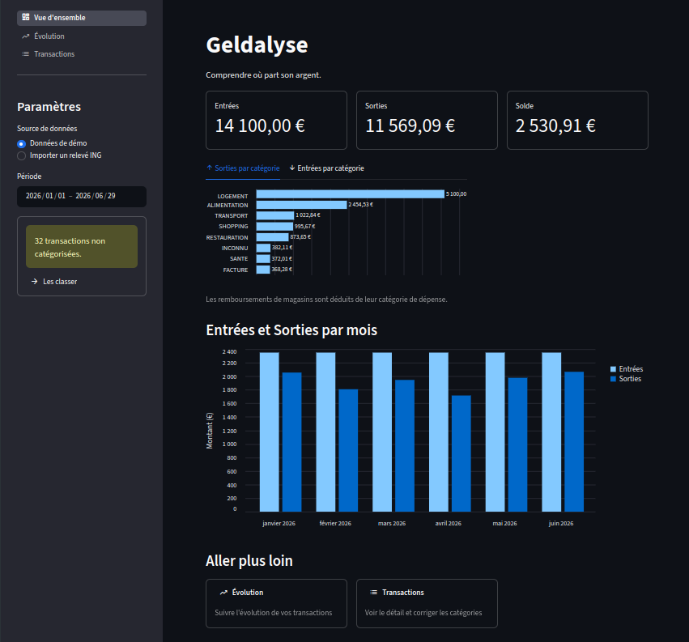
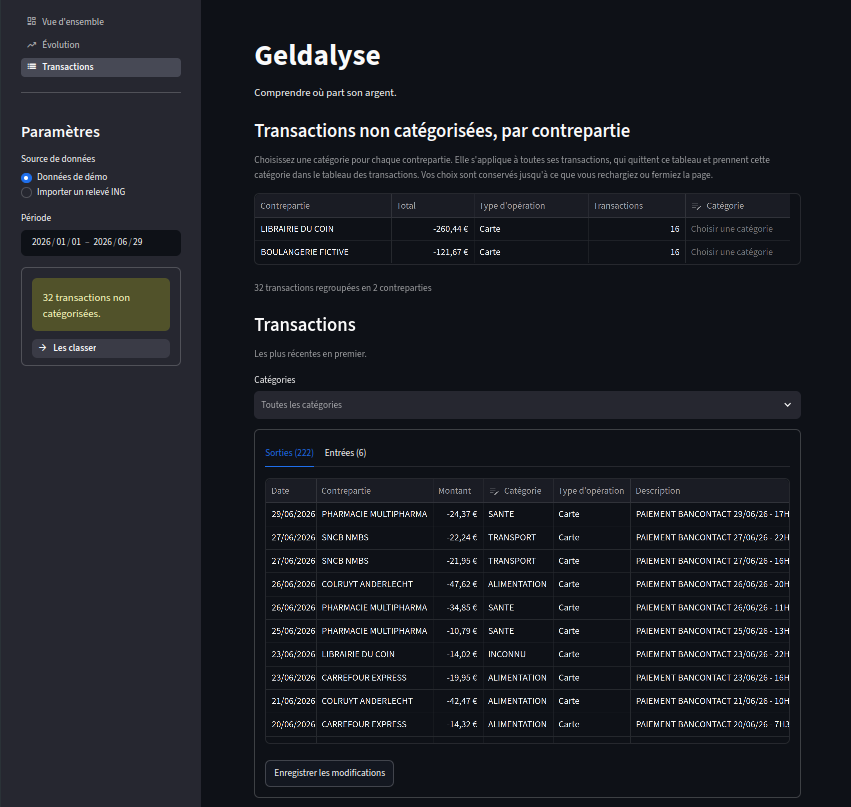
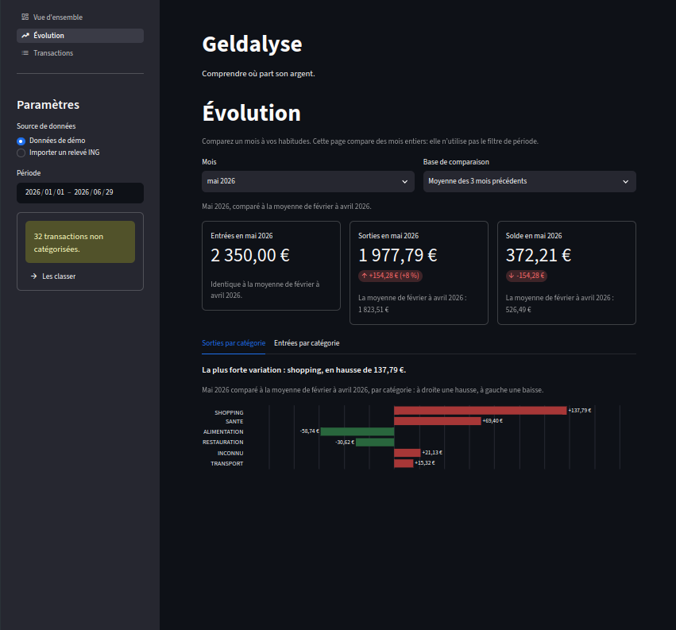

# Geldalyse

[](https://github.com/maxime2k/geldalyse/actions/workflows/tests.yml)

> Comprendre où part son argent, en quelques secondes.

Geldalyse est une application Python qui importe un relevé bancaire, catégorise automatiquement les transactions et affiche un tableau de bord des entrées et des sorties d'argent.


**[Voir la démo en ligne](https://geldalyse.streamlit.app/)**

---

## Fonctionnalités

- **Deux sources de données** : un relevé de démo au format ING, généré à la volée et lu comme un vrai relevé, ou votre propre export CSV d'ING Belgique (en français)
- **Nettoyage automatique** : colonnes renommées, dates converties, libellés normalisés, lignes vides supprimées
- **Catégorisation automatique** selon les mots-clés et le sens de l'argent : entrées et sorties ont leurs propres catégories
- **Contrepartie lisible** : le commerçant, le bénéficiaire d'un virement ou la nature d'une opération bancaire, extrait de la longue description de la banque
- **Correction manuelle des catégories**, pour toutes les transactions d'une même contrepartie
- **Import vérifié** : un montant ou une date invalide refuse le relevé, avec la ligne en cause, plutôt que de fausser les chiffres. Les montants avec séparateur de milliers sont acceptés
- **Tableau de bord interactif**, en trois pages :
  - **Vue d'ensemble** : entrées, sorties et solde de la période, détail par catégorie et mois par mois
  - **Transactions** : opérations à classer et tableau détaillé des transactions
 
  - **Évolution** : un mois comparé au mois précédent, à la moyenne des 3 mois précédents ou au même mois l'an passé, avec les écarts par catégorie

Le contenu de chaque page et les règles de calcul sont décrits dans la [conception du tableau de bord](docs/dashboard.md).

## Architecture

Le projet suit un schéma **ETL** (*Extract, Transform, Load*). Chaque étape est un module indépendant et testé.

| Étape | Module | Rôle |
|---|---|---|
| Extract | `readers/` | Lit un export bancaire : un lecteur par banque, qui valide les données et déchiffre les libellés |
| Extract | `generator.py` | Génère des transactions fictives reproductibles |
| Transform | `categorizer.py` | Attribue une catégorie selon le type d'opération, les mots-clés et le signe du montant, et applique les choix manuels |
| Transform | `analysis.py` | Calcule les chiffres clés et les agrégats |
| Load | `app.py` | Point d'entrée : barre latérale, chargement des données et navigation |
| Load | `views/` | Une page du tableau de bord par fichier |
| Load | `components.py` | Fonctions d'affichage partagées par les pages |
| Load | `formatting.py` | Met en forme les résultats en français (mois, montants, écarts) |

Chaque banque a son lecteur, qui hérite de la classe `BankReader` et produit le **format standard** défini dans `schema.py` : la date, le montant, la description, la contrepartie et le type d'opération. Le reste de l'application ne travaille que sur ce format. Ajouter une banque ne demande donc qu'un nouveau lecteur.

La démo suit le même chemin : le générateur écrit un export ING, que l'application lit avec le lecteur ING, comme un relevé importé.

La logique (`src/geldalyse/`) ne dépend pas de Streamlit : elle est testée seule, et pourrait servir une autre interface.

```
geldalyse/
├── app.py                  # Point d'entrée : barre latérale, chargement et navigation
├── components.py           # Fonctions d'affichage partagées par les pages
├── views/
│   ├── evolution.py        # Évolution : un mois comparé à une base
│   ├── overview.py         # Vue d'ensemble : chiffres clés, catégories, mois par mois
│   └── transactions.py     # Transactions : non catégorisées et tableau modifiable
├── src/geldalyse/
│   ├── readers/
│   │   ├── __init__.py     # read_statement : lit un relevé, quelle que soit la banque
│   │   ├── base.py         # BankReader : le contrat commun à tous les lecteurs
│   │   └── ing.py          # Lecture, validation et libellés des exports ING
│   ├── analysis.py         # Chiffres clés, agrégats et variations
│   ├── categorizer.py      # Catégorisation par mots-clés et signe du montant
│   ├── formatting.py       # Textes en français : mois, montants, écarts
│   ├── generator.py        # Relevé fictif au format ING
│   └── schema.py           # Format standard des données
├── tests/                  # Tests unitaires et d'intégration (pytest)
│   └── fixtures/           # Relevés synthétiques, valides et invalides
├── docs/                   # Conception du tableau de bord
└── .github/workflows/      # Intégration continue (GitHub Actions)
```

## Qualité et intégration continue

- **Tests unitaires et d'intégration** avec pytest, dont une partie écrite en TDD
- **Code vérifié et formaté** avec Ruff, en local et dans la CI
- **Intégration continue** : les tests et Ruff sont lancés automatiquement par GitHub Actions à chaque push et à chaque pull request
- **Branche `main` protégée** : toute modification passe par une pull request, fusionnable uniquement si toutes les vérifications passent
- **Déploiement continu** : l'application en ligne est mise à jour automatiquement à chaque fusion dans `main`

## Stack technique

| Rôle | Outil |
|---|---|
| Langage | Python 3.10+ |
| Manipulation des données | pandas, NumPy |
| Interface | Streamlit |
| Graphiques | Altair |
| Tests | pytest |
| Intégration continue | GitHub Actions |
| Hébergement | Streamlit Community Cloud |

## Installation

```bash
git clone https://github.com/maxime2k/geldalyse.git
cd geldalyse
python3 -m venv .venv
source .venv/bin/activate          # Windows : .venv\Scripts\activate
pip install -r requirements.txt
```

Sous Ubuntu ou Debian, si la création de l'environnement virtuel échoue, installez d'abord le paquet `python3-venv`.

Sans Git, vous pouvez aussi télécharger le projet depuis GitHub : bouton **Code**, puis **Download ZIP**. Décompressez l'archive, ouvrez un terminal dans le dossier, puis reprenez à partir de `python3 -m venv .venv`.

## Utilisation

**Lancer le tableau de bord :**

```bash
streamlit run app.py
```

Choisissez ensuite la source dans la barre latérale : les données de démo, ou votre propre export ING au format CSV (en français, depuis Home'Bank).

**Générer un relevé de démo au format ING :**

```bash
python -m geldalyse.generator
```

Le fichier `data/ing_demo_export.csv` peut ensuite être importé dans l'application, comme un vrai relevé.

**Lancer les tests :**

```bash
pip install -e ".[dev]"
pytest
```

## Données et confidentialité

Le dépôt ne contient **aucune donnée bancaire réelle**. Les tests utilisent des fixtures synthétiques qui reproduisent la structure d'un export ING, avec un contenu entièrement inventé. Un relevé importé n'est jamais enregistré : il est traité en mémoire le temps de la session, tout comme les catégories choisies manuellement, perdues à la fermeture de la page.

Sur la version en ligne, ce traitement a lieu sur les serveurs de Streamlit Cloud : l'application demande donc de cocher une case avant tout import. Pour analyser vos propres relevés, **utilisez l'application en local** : vos données ne quittent alors jamais votre ordinateur.

## Feuille de route

### V1 — terminée
- [x] Import d'un relevé de transactions au format CSV (export ING en français)
- [x] Nettoyage des données (dates, montants, libellés)
- [x] Catégorisation automatique par mots-clés
- [x] Tableau de bord : chiffres clés, dépenses par catégorie et par mois
- [x] Filtre par catégorie et indicateur des transactions non catégorisées

### V2 — en cours

**Données et import**
- [x] Contrepartie extraite de chaque description (commerçant, bénéficiaire d'un virement, opération bancaire)
- [x] Type d'opération reconnu pour chaque transaction : carte, virement, domiciliation, ordre permanent, espèces, opération bancaire
- [x] Un lecteur par banque, derrière la classe commune `BankReader` : ajouter une banque ne demande qu'un lecteur
- [x] Générateur produisant des relevés fictifs au format ING, lus par le lecteur ING
- [ ] Exports ING en néerlandais, anglais et allemand
- [ ] Prise en charge d'autres banques (BNP Paribas Fortis, Belfius…)
- [ ] Import de jeux de données publics (Kaggle, UCI) via le même format standard
- [ ] Simulation des montants par une loi log-normale plutôt qu'uniforme
- [ ] Utiliser le détail du mouvement quand la description est trop générique (ex. « Rectification »)
- [ ] Tendance des entrées et des sorties sur toute la période, avec le mois choisi mis en évidence (page Évolution)

**Catégorisation**
- [x] Prise en compte du signe du montant (entrées et sorties, catégories par défaut)
- [ ] Recherche des mots-clés en début de mot, pour ajouter des enseignes comme ACTION sans reconnaître « TRANSACTION »
- [ ] Mots-clés stockés dans un fichier de configuration, modifiables sans toucher au code
- [ ] Mots-clés personnels de l'utilisateur, enregistrés en local
- [ ] Mots-clés des opérations bancaires dans chaque langue d'export
- [ ] Catégorie « Virements » pour les virements envoyés à des particuliers
- [ ] Distinction entre abonnements de loisirs (Netflix…) et factures essentielles (Proximus…)
- [ ] Suivi du taux de couverture (part des transactions catégorisées)
- [ ] Catégorisation par apprentissage automatique

**Modèle Entrées / Sorties**
- [x] Chiffres clés « Entrées / Sorties / Solde » et graphique du détail des entrées
- [x] Totaux nets par catégorie : un remboursement de magasin réduit sa catégorie de dépense
- [x] Catégories proposées selon le sens de l'argent dans les choix manuels
- [x] Correction de la catégorie depuis le tableau des transactions, pour toute l'opération
- [ ] Identifiant de transaction (numéro de mouvement ING)
- [ ] Correction de la catégorie d'une seule transaction

**Interface**
- [x] Application en plusieurs pages (Vue d'ensemble, Transactions, Évolution)
- [x] Mise en page large, chiffres clés en cartes et liens vers les autres pages
- [ ] Graphiques par catégorie en colonne, à côté des faits marquants
- [ ] Nom et logo de l'application dans la barre latérale

**Tableau de bord**
- [x] Transactions non catégorisées regroupées par contrepartie, pour enrichir les mots-clés
- [x] Correction manuelle de la catégorie d'une opération non catégorisée
- [x] Comparaison d'un mois au mois précédent, à la moyenne des 3 mois précédents ou au même mois l'an passé, avec les écarts par catégorie (page Évolution)
- [ ] Faits marquants sur la vue d'ensemble (plus forte variation du mois)
- [ ] Paiements récurrents et total des charges fixes (page Habitudes), détectés par libellé, montant proche et fréquence mensuelle
- [ ] Top des dépenses variables, hors paiements récurrents
- [ ] Sorties regroupées par commerçant (nombre d'achats et total), filtrables par catégorie
- [ ] Détection des dépenses inhabituelles
- [ ] Budgets par catégorie avec alertes

**Qualité**
- [x] Vérification et formatage du code avec Ruff, dans la CI
- [x] Exception personnalisée pour les relevés invalides
- [ ] Tests sur plusieurs versions de Python (matrice CI)


## Auteur

**Maxime Kamgue Kamgue** — [LinkedIn](https://www.linkedin.com/in/maxime-kamgue-kamgue) · [GitHub](https://github.com/maxime2k)